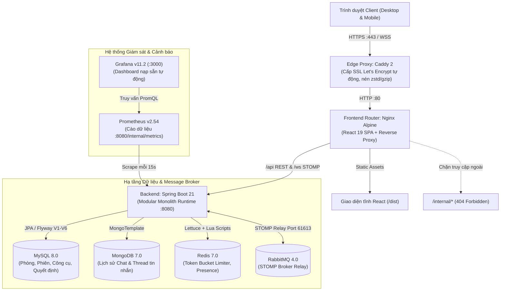
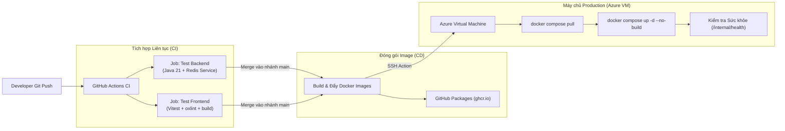

# EventChat

[](https://github.com/Khanhnv26/Event-ChatX/actions/workflows/ci.yml)
[](https://openjdk.org/projects/jdk/21/)
[](https://spring.io/projects/spring-boot)
[](https://react.dev/)
[](https://www.typescriptlang.org/)
[](https://www.docker.com/)
[](LICENSE)

**EventChat** là nền tảng cộng tác và điều phối sự kiện thời gian thực (real-time) hiệu năng cao, được thiết kế theo kiến trúc **Modular Monolith**. Nền tảng hướng tới các sự kiện tạm thời, hội thảo (workshop), townhall và họp nhóm tương tác, tích hợp khả năng chat tức thời cùng bộ công cụ sống động (**Living Tools**) bao gồm: bình chọn (Poll), vòng quay may mắn (Lucky Wheel), biểu quyết quyết định (Decision Tracking) và tự động xuất biên bản cuộc họp (Meeting Minutes Export).

---

## Mục lục

- [Điểm nổi bật & Kiến trúc Hệ thống](#điểm-nổi-bật--kiến-trúc-hệ-thống)
  - [Sơ đồ Kiến trúc Tổng thể](#sơ-đồ-kiến-trúc-tổng-thể)
  - [Chiến lược Đa Cơ sở Dữ liệu (Polyglot Persistence)](#chiến-lược-đa-cơ-sở-dữ-liệu-polyglot-persistence)
  - [Quy trình GitOps CI/CD & Tự động Triển khai](#quy-trình-gitops-cicd--tự-động-triển-khai)
- [4 Trụ cột Tính năng Cốt lõi](#4-trụ-cột-tính-năng-cốt-lõi)
- [Cấu trúc Thư mục Dự án](#cấu-trúc-thư-mục-dự-án)
- [Hướng dẫn Khởi chạy](#hướng-dẫn-khởi-chạy)
  - [Yêu cầu Môi trường](#yêu-cầu-môi-trường)
  - [Nhánh 1: Chạy Môi trường Phát triển (Local Dev)](#nhánh-1-chạy-môi-trường-phát-triển-local-dev)
  - [Nhánh 2: Chạy Môi trường Production (Docker Compose)](#nhánh-2-chạy-môi-trường-production-docker-compose)
- [Hệ thống Giám sát & Đo lường (Observability)](#hệ-thống-giám-sát--đo-lường-observability)
- [Kiểm thử & Đảm bảo Chất lượng](#kiểm-thử--đảm-bảo-chất-lượng)
- [Bảo mật & Chống Spam (Rate Limiting)](#bảo-mật--chống-spam-rate-limiting)
- [Tài liệu Kỹ thuật & API](#tài-liệu-kỹ-thuật--api)

---

## Điểm nổi bật & Kiến trúc Hệ thống

EventChat tuân thủ triết lý **"Modular in Code, Monolith in Deployment"** (Mô-đun hóa trong mã nguồn, đóng gói nguyên khối khi triển khai). Phía Backend phân chia ranh giới rõ ràng giữa các domain nghiệp vụ (`room`, `chat`, `decision`, `interaction`, `export`) thông qua interface công khai và sự kiện nội bộ Spring Application Events, nhưng được đóng gói thành 1 Docker image duy nhất chạy cùng hệ thống proxy và cơ sở dữ liệu chuyên biệt.

### Sơ đồ Kiến trúc Tổng thể



### Chiến lược Đa Cơ sở Dữ liệu (Polyglot Persistence)

Thay vì ép toàn bộ dữ liệu vào một database duy nhất, EventChat phân định nhiệm vụ chính xác cho từng loại công nghệ lưu trữ:

| Cơ sở Dữ liệu | Công nghệ | Dữ liệu Đảm nhận | Lý do Kiến trúc |
| :--- | :--- | :--- | :--- |
| **Dữ liệu Quan hệ** | **MySQL 8.0** | Thông tin phòng, Host token, số lượng thành viên, cấu hình Poll/Wheel, trạng thái Decision. | Giao dịch ACID nghiêm ngặt, ràng buộc khóa ngoại, quản lý tiến hóa lược đồ bất biến qua Flyway migrations V1–V6. |
| **Dữ liệu Hướng tài liệu** | **MongoDB 7.0** | Tin nhắn chat tức thời, liên kết trả lời (reply-to), chuỗi định danh tin nhắn. | Tối ưu hóa ghi chèn khối lượng lớn (append-only), linh hoạt schema, phân vùng truy vấn cực nhanh theo `roomId`. |
| **Bộ nhớ Đệm In-Memory** | **Redis 7.0** | Giới hạn tốc độ Token Bucket phân tán, nhịp tim Presence người dùng online, danh sách phiên bị thu hồi (kicked). | Thao tác nguyên tử qua Redis Lua script độ trễ mili-giây, cơ chế TTL tự hủy khóa, đồng bộ trạng thái tức thì giữa các instance. |
| **Message Broker** | **RabbitMQ 4.0** | Relay giao thức STOMP, phân phối bản tin phòng chat (`/topic/rooms/{roomId}/*`). | Bộ định tuyến tin nhắn chuyên dụng, giải phóng kết nối WebSocket khỏi tải xử lý logic của backend. |

### Quy trình GitOps CI/CD & Tự động Triển khai

Mọi dòng code đẩy lên GitHub đều được kiểm thử tự động và cập nhật trực tiếp lên máy chủ mà không cần thao tác biên dịch thủ công trên server:



---

## 4 Trụ cột Tính năng Cốt lõi

### 1. Quản lý Vòng đời Phòng & Định danh Ẩn danh
- **Tùy chỉnh Thời gian Sống (TTL)**: Cho phép thiết lập phòng tồn tại từ 5 phút đến 7 ngày (mặc định 24 giờ).
- **Quyền hạn Chủ phòng (Host)**: Người tạo phòng nhận một Bearer Secret lưu tại session. Chỉ Host mới có quyền khóa phòng, tạo công cụ, kick thành viên hoặc xuất biên bản.
- **Giới hạn Sức chứa & Khóa nhận Thành viên**: Kiểm soát tối đa 50 người/phòng. Host có thể bật "Khóa vào phòng" để từ chối người mới tham gia trong khi các thành viên hiện tại vẫn hoạt động bình thường.
- **Thu hồi Phiên & Đuổi Thành viên (Kick)**: Host có thể kick thành viên có hành vi xấu; quyền truy cập bị thu hồi ngay lập tức trên cả tầng REST API và WebSocket STOMP.

### 2. Nhắn tin Tức thời Hiệu năng cao
- **Độ trễ Dưới 50ms**: Nhận và phát tin tức thời qua giao thức WebSocket STOMP do RabbitMQ phân phối.
- **Trích dẫn & Trả lời (Reply-To)**: Hỗ trợ chọn tin nhắn gốc, xem trước trích dẫn và liên kết trực tiếp tới ngữ cảnh cuộc trò chuyện.
- **Nhận diện Hiện diện (Presence)**: Nhịp tim socket cập nhật mỗi 5 giây, hiển thị chính xác danh sách những người đang online thực tế và tự động ngắt sau 30 giây mất kết nối.

### 3. Bộ Công cụ Tương tác Sống động (Living Tools)
- **Bình chọn Trực tiếp (Live Polls)**: Hỗ trợ câu hỏi đơn lựa chọn hoặc đa lựa chọn do Host khởi tạo độc quyền; cơ chế khóa ghi an toàn khi có nhiều người cùng bỏ phiếu đồng thời.
- **Vòng quay May mắn (Lucky Wheel)**: Chọn ngẫu nhiên mục trúng thưởng kèm hiệu ứng pháo hoa Confetti và tùy chọn "Loại bỏ người thắng" (Exclude Winner) tránh trùng lặp.
- **Biểu quyết Quyết định Nhóm (Consensus Decisions)**: Quy trình đề xuất minh bạch. Bất kỳ thành viên nào cũng có thể gửi đề xuất; mọi người cùng vote tán thành/phản đối và Host là người đưa ra quyết định chốt cuối cùng.

### 4. Xuất Biên bản Họp & Dọn dẹp Dữ liệu Tự động
- **Xuất Báo cáo Đa định dạng**: Tổng hợp toàn bộ diễn biến sự kiện ra file JSON hoặc Markdown tiêu chuẩn (bao gồm kết quả các cuộc bình chọn, lịch sử vòng quay, các quyết định đã chốt và số liệu thống kê).
- **Cơ chế Dọn dẹp Dữ liệu (7-Day Retention Purge)**: Tác vụ định kỳ tự động quét các phòng đã hết hạn quá 7 ngày, xóa triệt để lịch sử chat MongoDB, bảng quan hệ MySQL và dọn dẹp các cache key liên quan.

---

## Cấu trúc Thư mục Dự án

```text
├── backend/                  # Mã nguồn Spring Boot 3.3 / Java 21
│   ├── src/main/java/        # Các module nghiệp vụ (room, chat, decision, interaction, export)
│   ├── src/main/resources/   # Cấu hình application, Flyway migrations (V1-V6)
│   └── Dockerfile            # Multi-stage Docker build trên nền Eclipse Temurin JRE
├── frontend/                 # Mã nguồn React 19 / TypeScript / Vite
│   ├── src/                  # Components, routes, custom hooks, STOMP clients
│   ├── tests/                # Bộ kiểm thử giao diện bằng Vitest & React Testing Library
│   ├── nginx.conf            # Cấu hình Nginx reverse proxy và định tuyến an toàn
│   └── Dockerfile            # Multi-stage build Node 24 sang Nginx Alpine
├── deploy/                   # File cấu hình môi trường triển khai
│   ├── Caddyfile             # Caddy reverse proxy, cấp SSL và gán security headers
│   ├── rabbitmq-plugins      # Plugin STOMP kích hoạt sẵn cho RabbitMQ
│   ├── prometheus.yml        # Cấu hình cào dữ liệu Prometheus
│   ├── grafana-datasource.yml# Tự động kết nối Prometheus vào Grafana
│   ├── grafana-dashboard-provider.yml # Khai báo tự động nạp dashboard
│   └── dashboards/           # File JSON định nghĩa sẵn biểu đồ Grafana
├── docs/                     # Tài liệu thiết kế, API và hướng dẫn vận hành chi tiết
│   ├── api/                  # Hợp đồng REST API & đặc tả OpenAPI 3.0
│   ├── deployment.md         # Quy trình vận hành production, backup và cấp SSL
│   ├── testing.md            # Báo cáo kiểm thử, kịch bản tải và hướng dẫn chạy test
│   └── design/MASTER.md      # Bộ quy chuẩn thiết kế UI Design System (màu sắc, font chữ)
├── scripts/acceptance/       # Kịch bản kiểm thử tích hợp đầu-cuối (E2E), tải và chịu lỗi
├── .github/workflows/        # Pipeline GitHub Actions (Test, GHCR Build, SSH Deploy)
├── docker-compose.yml        # Chạy hạ tầng phụ trợ môi trường phát triển (Redis + RabbitMQ)
└── compose.production.yaml   # Toàn bộ hệ thống 9 services chạy Production hoàn chỉnh
```

---

## Hướng dẫn Khởi chạy

### Yêu cầu Môi trường

- **Java Development Kit (JDK)**: Phiên bản 21 (khuyên dùng Eclipse Temurin).
- **Node.js**: Phiên bản 24+ kèm công cụ npm.
- **Docker & Docker Compose**: Docker Engine phiên bản 24+ hoặc Docker Desktop.

---

### Nhánh 1: Chạy Môi trường Phát triển (Local Dev)

Dành cho lập trình viên muốn sửa code và kiểm tra tính năng trực tiếp trên máy:

1. **Clone mã nguồn về máy:**
   ```bash
   git clone https://github.com/Khanhnv26/Event-ChatX.git
   cd Event-ChatX
   ```

2. **Khởi chạy hạ tầng phụ trợ (Redis + RabbitMQ):**
   ```bash
   docker compose up -d
   ```

3. **Khởi chạy Backend (Terminal 1):**
   ```bash
   cd backend
   mvn spring-boot:run
   ```
   *Backend sẽ khởi động tại cổng `8080`.*

4. **Khởi chạy Frontend (Terminal 2):**
   ```bash
   cd frontend
   npm ci
   npm run dev
   ```
   *Mở trình duyệt tại [http://localhost:5173](http://localhost:5173). Vite sẽ tự động chuyển tiếp các yêu cầu `/api` và `/ws` về cổng `8080`.*

---

### Nhánh 2: Chạy Môi trường Production (Docker Compose)

Bộ cấu hình production đóng gói trọn vẹn **9 services** (**MySQL, MongoDB, Redis, RabbitMQ, Backend, Frontend, Caddy Proxy, Prometheus, Grafana**) có thể chạy ngay chỉ bằng 1 lệnh:

1. **Tạo file cấu hình môi trường `.env`:**
   ```bash
   cp .env.example .env
   ```
   Điền tên miền và các chuỗi mật khẩu bảo mật vào file `.env`:
   ```env
   APP_DOMAIN=chat.yourdomain.com
   APP_ALLOWED_ORIGINS=https://chat.yourdomain.com
   MYSQL_PASSWORD=chuoi_hex_ngau_nhien_1
   MYSQL_ROOT_PASSWORD=chuoi_hex_ngau_nhien_2
   MONGO_PASSWORD=chuoi_hex_ngau_nhien_3
   REDIS_PASSWORD=chuoi_hex_ngau_nhien_4
   RABBITMQ_PASSWORD=chuoi_hex_ngau_nhien_5
   GRAFANA_PASSWORD=mat_khau_admin_grafana
   ```

2. **Khởi chạy toàn bộ hệ thống:**
   ```bash
   docker compose -f compose.production.yaml up -d --build
   ```

3. **Kiểm tra trạng thái các container:**
   ```bash
   docker compose -f compose.production.yaml ps
   ```
   *Tất cả 9 container sẽ báo trạng thái `healthy` hoặc `Up`. Caddy sẽ tự động xin cấp chứng chỉ SSL Let's Encrypt tại cổng 80 và 443 cho domain của bạn.*

---

## Hệ thống Giám sát & Đo lường (Observability)

EventChat tích hợp sẵn hệ thống quan sát thông số mà không cần người dùng tự cấu hình tay:

- **Thu thập Số liệu**: Prometheus tự động cào thông số từ endpoint nội bộ `/internal/metrics` mỗi 15 giây.
- **Bảng điều khiển Grafana Tự động**: Truy cập `http://<IP_MAY_CHU>:3000` (Tài khoản: `admin` / Mật khẩu: `GRAFANA_PASSWORD`):
  - 📈 **HTTP Throughput (RPS)**: Đo lường tốc độ request/giây theo thời gian thực.
  - 🛑 **5xx Server Errors**: Cảnh báo số lỗi hệ thống phát sinh tức thời.
  - 🛡️ **Rate-Limiting (HTTP 429)**: Thống kê số lượng yêu cầu bị chặn spam theo giây.
  - ⏱️ **Average Latency**: Biểu đồ độ trễ xử lý trung bình (đơn vị ms).
- **Kiểm tra Sức khỏe Hệ thống (Health Check)**:
  ```bash
  docker compose -f compose.production.yaml exec backend wget -q -O - http://localhost:8080/internal/health
  ```
  *Trả về `{"status": "UP"}` khi MySQL, MongoDB, Redis và RabbitMQ đều sẵn sàng hoạt động.*

---

## Kiểm thử & Đảm bảo Chất lượng

Hệ thống được bảo vệ bởi bộ kiểm thử tự động toàn diện từ Unit Test, Integration Test đến Kiểm thử Tải:

```bash
# Chạy bộ test backend (Bao gồm kiểm thử tích hợp Redis Token Bucket thật)
cd backend
EVENTCHAT_TEST_REDIS=true mvn test

# Chạy kiểm thử frontend, kiểm tra linter và type check bản build
cd ../frontend
npm test
npm run lint
npm run build

# Chạy các kịch bản kiểm thử nghiệm thu đầu cuối (Chạy từ thư mục gốc)
node scripts/acceptance/run.mjs
node scripts/acceptance/capacity.mjs
node scripts/acceptance/load-smoke.mjs
```

Chi tiết kịch bản kiểm thử và kết quả đo lường tải xem tại [docs/testing.md](docs/testing.md).

---

## Bảo mật & Chống Spam (Rate Limiting)

- **Thuật toán Token Bucket Phân tán**: Triển khai trực tiếp bằng Redis Lua Script nguyên tử (`RateLimitInterceptor.java`). Cho phép burst tối đa 5 token và hồi phục đều đặn 0.5 token/giây.
- **Chống Giả mạo IP (Anti-Spoofing)**: Chỉ tin cậy các proxy nội bộ được cấu hình tường minh (`172.28.240.10`, `172.28.240.11`) qua `APP_RATE_LIMIT_TRUSTED_PROXIES`. Tiêu đề `X-Forwarded-For` từ bên ngoài gửi vào bị bỏ qua.
- **Che giấu Endpoint Nội bộ**: Nginx chủ động trả mã `404 Not Found` với mọi truy vấn hướng tới `/internal/*` từ mạng công cộng.
- **Xác thực Bearer Token Nghiêm ngặt**: Các thao tác nhạy cảm (khóa phòng, kick người dùng, xuất biên bản) bắt buộc có Host Bearer Token. Kênh STOMP kiểm soát khớp chính xác tên topic để chống nghe lén tin nhắn phòng khác.

---

## Tài liệu Kỹ thuật & API

- **[Tài liệu Chi tiết REST & WebSocket API](docs/api/README.md)**: Cấu trúc request/response, mã lỗi chi tiết và hợp đồng STOMP.
- **[Đặc tả Chuẩn OpenAPI 3.0](docs/api/openapi.json)**: File mô tả API chuẩn hóa cho Postman và Swagger.
- **[Quy trình Triển khai & Vận hành Production](docs/deployment.md)**: Hướng dẫn sao lưu (backup), phục hồi dữ liệu và cấu hình SSL.
- **[Quy chuẩn Hệ thống Thiết kế (Design System)](docs/design/MASTER.md)**: Bảng màu, typography và tiêu chuẩn chuyển động UI.
- **[Kế hoạch Hoàn thiện MVP](docs/plans/mvp-completion.md)**: Lộ trình tính năng, quyết định kỹ thuật và tiêu chí nghiệm thu.

---

## Giấy phép (License)

Dự án được phân phối dưới giấy phép [MIT License](LICENSE).
