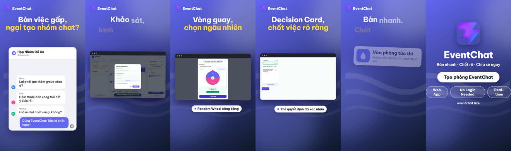

# EventChat Promo Video

> **Bàn nhanh. Chốt rõ. Chia sẻ ngay.**  
> Bộ video giới thiệu sản phẩm (Promo / Product Reel) code-driven chất lượng cao dành cho **EventChat**, được tối ưu cho các nền tảng mạng xã hội (TikTok, Reels, Shorts, YouTube, Facebook, LinkedIn).

---

## 1. Video Thành phẩm

| Định dạng | Độ phân giải | Thời lượng | Tệp tin |
| :--- | :--- | :--- | :--- |
| **Dọc (9:16)** | 1080 × 1920 (Full HD) | 42.0s · 30fps | [`out/launch-vi-9x16.mp4`](./out/launch-vi-9x16.mp4) |
| **Ảnh bìa (Cover)** | 1080 × 1920 | - | [`out/launch-vi-9x16-cover.jpg`](./out/launch-vi-9x16-cover.jpg) |
| **Dải ảnh Filmstrip** | 6 khung hình đại diện | - | [`out/video-sheet.jpg`](./out/video-sheet.jpg) |
| **Bảng phân cảnh** | 8 scenes contact sheet | - | [`out/stills/launch-vi/sheet-9x16.jpg`](./out/stills/launch-vi/sheet-9x16.jpg) |



---

## 2. Kịch bản & Tính năng (8 Phân cảnh)

Video bám sát 100% tài liệu đặc tả nghiệp vụ **`EventChat_SRS_V1`**:

1. **Scene 1 (Hook - Điểm đau):** *Bàn việc gấp, ngại tạo nhóm chat?* — Tình huống nhóm trao đổi đồ án / dự án ngại lập group rác và sợ trôi kết luận.
2. **Scene 2 (Vào phòng tức thì - FR-01/02):** *Vào phòng ngay, không cần đăng ký* — Quét QR hoặc mở liên kết, chọn nickname là tham gia ngay lập tức.
3. **Scene 3 (Live Poll - FR-06):** *Khảo sát, bình chọn tức thì* — Biểu quyết tập thể không độ trễ, đồng bộ thời gian thực.
4. **Scene 4 (Random Wheel - FR-07):** *Vòng quay, chọn ngẫu nhiên* — Vòng quay may mắn minh bạch, công bằng khi có nhiều lựa chọn.
5. **Scene 5 (Decision Card - FR-08):** *Decision Card, chốt việc rõ ràng* — Thẻ ghi nhận quyết định chính thức đã xác nhận, không lo trôi ý kiến.
6. **Scene 6 (Xuất biên bản - FR-09):** *Xuất biên bản, chia sẻ ngay 1-click* — Tự động tổng hợp báo cáo kết quả Markdown / Text.
7. **Scene 7 (Trio Features):** Tóm lược 3 giá trị cốt lõi: *Bàn nhanh · Chốt rõ · Chia sẻ ngay*.
8. **Scene 8 (End Card):** Logo SVG chính thức, slogan và nút CTA *"Tạo phòng EventChat"*.

---

## 3. Cấu trúc thư mục

```text
promo/
├── ads.json                # Cấu hình thương hiệu (màu sắc, icon, badges, tính năng)
├── scripts/
│   └── launch-vi.json      # Kịch bản 8 phân cảnh tiếng Việt
├── screens/                # Ảnh chụp màn hình UI thực tế (chat, poll, wheel, decision, export)
├── assets/                 # Logo icon SVG và các icon phụ trợ
├── out/                    # Thư mục chứa video thành phẩm, ảnh bìa và filmstrip
└── README.md               # Tài liệu hướng dẫn
```

---

## 4. Hướng dẫn Dựng (Render) Video

### Yêu cầu môi trường
* Node.js 18+
* Google Chrome / Chromium
* FFmpeg & FFprobe
* Python 3 (dùng để tổng hợp nhạc nền tự động)
* Skill `app-promo-video` đã cài đặt toàn cục (`promo-video`)

### Các lệnh hữu ích

1. **Kiểm tra tính hợp lệ của kịch bản:**
   ```powershell
   promo-video check scripts/launch-vi.json
   ```

2. **Xem trước phân cảnh dạng ảnh (Stills preview - không cần chờ render video):**
   ```powershell
   promo-video stills scripts/launch-vi.json --aspects 9x16
   ```

3. **Dựng video đầy đủ (Tỷ lệ 9:16 dọc):**
   ```powershell
   promo-video build scripts/launch-vi.json --aspects 9x16 --no-voice
   ```

4. **Dựng video cho các tỷ lệ khác (1:1 vuông hoặc 16:9 ngang):**
   ```powershell
   promo-video build scripts/launch-vi.json --aspects 1x1,16x9 --no-voice
   ```

5. **Kích hoạt giọng đọc AI (Voice-over):**
   Thiết lập `GEMINI_API_KEY` trong file `.env` hoặc biến môi trường, sau đó chạy lệnh build không kèm cờ `--no-voice`:
   ```powershell
   promo-video build scripts/launch-vi.json --aspects 9x16
   ```
